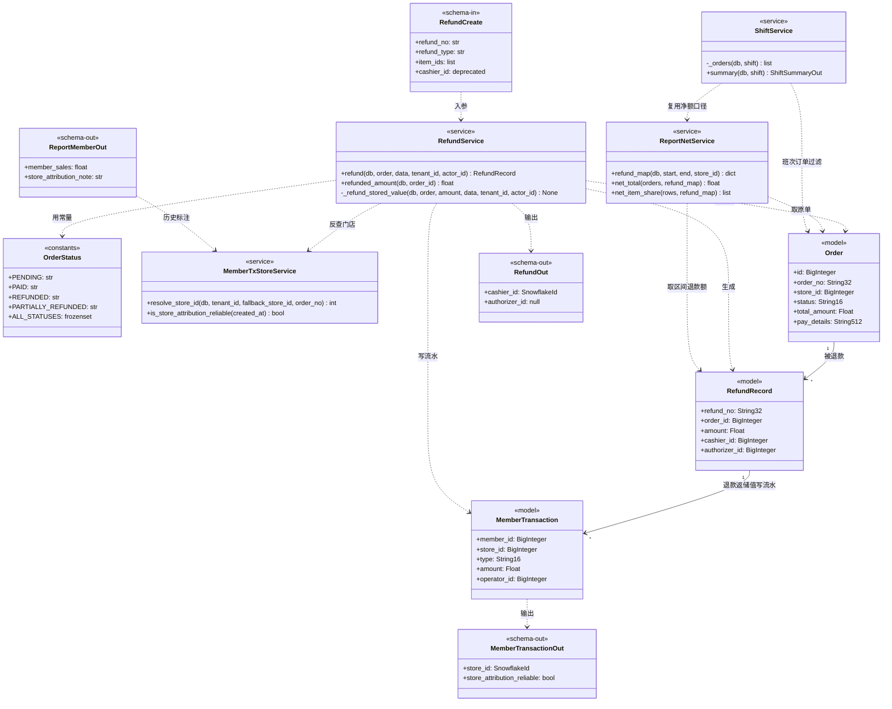
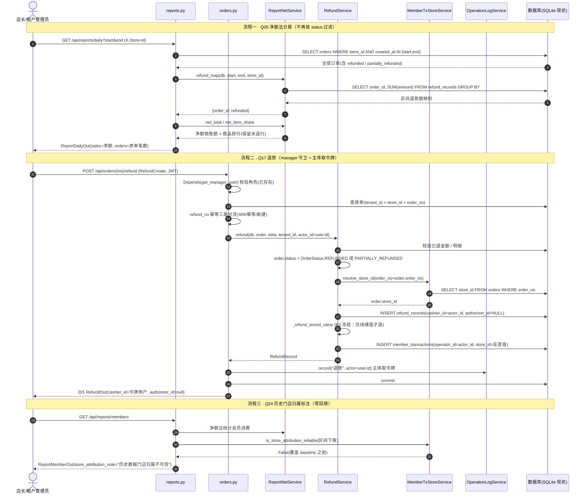
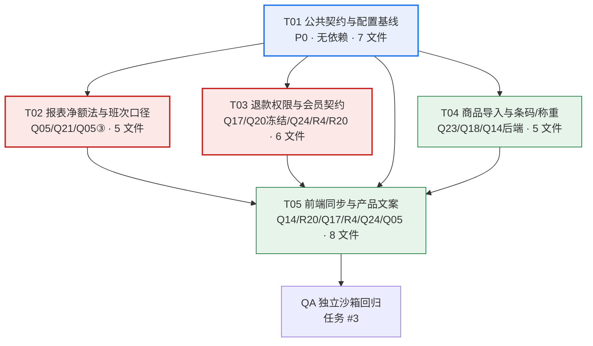
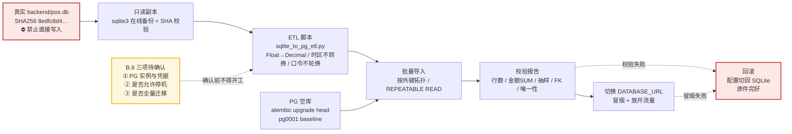

# 鲜衡云 B3 与 PostgreSQL 迁移增量设计

> **文档性质**：架构增量设计与任务分解（只设计、不实施、不改任何源码/配置）
> **编写**：架构师 高见远 ｜ 团队 `software-xianheng-b3` ｜ 任务 #1
> **日期**：2026-11-08
> **基准**：分支 `main`，HEAD `12e672d`（`docs: 记录 8 项拍板结论并排除弱口令轮换`），工作区干净；真实 `backend/pos.db` SHA256 `8edfc8d4…` 全程未变
> **上游依据**：`.trae/documents/电子秤收银系统整改清单.md` 第二节批次表、第六节 B3、第七节 B4、9.1 拍板结论、3.6 / 4.9 / 5.6 遗留风险表（R1–R20），以及当前源码逐文件核对
> **实施口径**：9.1 拍板结论为**不可自行变更**的口径，本文只做「落到哪个批次 / 哪些文件 / 什么契约」的判定与分解

---

## 0. 结论摘要

| 项 | 结论 |
|---|---|
| **B3 定位** | 「资金、报表与业务口径」增量修复批次；**不引入任何 Alembic 迁移、不做列类型/列宽改造、不做整库备份改造**。B3 全部在 SQLite 现状表结构上完成，可立即实施并独立回归 |
| **B3 九条判定** | 本批做 7 条（Q05 / Q24 / Q21 / Q14 / Q23 / Q17 / Q18）；随 PG 迁移 1 条（Q13）；随 B4 1 条（Q20）。详见 A.2 |
| **Q05③ 歧义** | **SQLite 阶段只做「订单状态枚举常量统一」，字段扩容 `String(16)→String(32)` 留到 PG baseline 一次性实施**。理由：SQLite 不校验长度、列宽变更需 `batch_alter_table` 重建表，而拍板 4 明确「不再走 SQLite batch 迁移」 |
| **Q20 歧义** | **随 B4 / Q06，B3 冻结现状**。提前改动会因 Q06 结算接口重新定义 `pay_details` 结构而整体返工，且「返前校验原单扣款流水」依赖 Q06 才存在的扣款流水，B3 无法实现 |
| **Q17 歧义** | 拍板 1「仅 manager 可退」优先；核对源码发现**退款已强制 manager 且已有操作日志**，故真正待修为「客户端可控主体字段 + 操作日志主体不可信 + 建档权限需求偏差登记」。建档权限**记为需求变更、不改代码** |
| **Q24 歧义** | 不重算历史；最小实现 = 新增「按订单反查 `store_id`」共享服务 + 「历史报表标注」响应字段 + 配置项分界，**零 DDL、零迁移、零回填** |
| **R20 / R5 / R4** | R20 → **本批做**（机制落地 + 数值参数化待产品确认）；R4 → **本批做**；R5 → **随 B4 / Q06+Q20**（严格遵守拍板，不提前改动） |
| **明确不做** | R18 复合唯一键、R16 全量 tombstone、R2 / R19 弱口令轮换（⛔ 用户明确「先不管」，禁止触碰、禁止执行轮换脚本） |
| **PG 迁移** | **独立批次，B4 的技术前置，不属于 B3**。选定 PostgreSQL 后 B4 由原估 2–3 人日重估为 **8–12 人日**，且 B3 中 7 类回归用例需因 PG 选型重写（详见 B.10） |
| **实施前置三问** | ① PG 实例与凭据来源 ② 是否允许停机窗口 ③ 既有 SQLite 数据是否全量迁移 —— **三项均由用户确认前不得开工**，详见 B.8 |

---

# Part A — B3 增量设计（可立即实施）

## A.1 实施口径基线（9.1 拍板结论，逐字遵守）

| # | 议题 | 拍板结论 | 本文对应的落地判定 |
|---|---|---|---|
| 1 | 退款权限（Q17） | **A · 仅 manager 可退**：收银员无退款入口，服务端加角色守卫；不做「本人当班」判定与 `authorizer_id` | B3 / T03、T05 |
| 2 | 会员流水历史门店归属（Q24） | **A · 不重算历史**：新数据按订单反查 `store_id`，历史报表标注「历史数据门店归属不可信」 | B3 / T01、T02、T03、T05 |
| 3 | 报表口径（Q05） | **A · 净额法**：销售额 = 原单金额 − 区间退款额；部分退款仍计 1 笔销售，商品排行按净额；与班次汇总统一，**报表不再依赖 `status == "paid"` 过滤** | B3 / T01、T02、T03 |
| 4 | 生产数据库（Q13 / Q32-5 / Q28） | **B · 切 PostgreSQL**；金额 `Numeric`/`Decimal`、状态 `String(32)` 随 PG 迁移一次性实施，**不再走 SQLite batch 迁移** | **PG 迁移批次**（非 B3） |
| 5 | 备份形态（Q01 / R3） | **A · 按租户脱敏导出** JSON/CSV + 操作日志，不含 `password_hash` 与他租户行；需另行定义恢复流程 | **PG 迁移批次**（非 B3） |
| 6 | 平台超管边界（Q30 / R9） | **A · 收窄只读审计**：super 跨租户可读，所有写接口统一拒绝；前端补只读态提示 | **B4**（与 Q32 安全子项合并） |
| 7 | 促销归属层级（Q19 / R15） | **A · 保持门店级 + 本地时间录入**：后台按门店本地时间录入 `start_at/end_at`，服务端统一转 UTC 比较，消除 8 小时偏移 | **B4**（与 Q19 后续合并，见 A.5） |
| 8 | 组合支付与整单折扣（Q06 / Q20） | **随 B4 一次补齐**，不单独开工 | **B4** |
| 9 | 输出 schema `store_id` 类型（Q32） | **随 Q32 统一改 `SnowflakeId`**，不单独改 | **B4 / Q32** |

**新增遗留处置**：R20 = A 严格（在线储值支付一并临时下线，离线订单限额 ≤200 元 / 补传时限 2 小时，**数值待产品确认**，后台与 POS 补文案）；R18 保持 `order_no` 全局唯一、不做复合键迁移；R4 复用现有 `rechargeGift` 做单位换算、清死字段 `bonus_points`；R5 赠金梯度收回服务端 + 频次/比例上限（资损必修，随 Q06/Q20 收口）；R16 暂不处理；**R2 / R19 弱口令用户明确指示「先不管」，禁止触碰、禁止执行轮换脚本**。

---

## A.2 范围判定表（B3 九条）

> 判定取值：**本批做** / **随 PG 迁移** / **随 B4** / **不做**。理由均基于当前源码核对，不以清单历史行号为准。

| 编号 | 条目 | 判定 | 理由（含源码核对依据） | 落地组 |
|---|---|---|---|---|
| **Q05** | 报表一致性（P0） | **本批做** | `reports.py:52/76/141/155` 五类报表均按 `Order.status=="paid"` 过滤，退款后整单消失；`shift_service.py:96-117` 已做净额扣减，两套口径矛盾。净额法是纯查询口径改造，**不依赖列类型、不依赖 PG、不依赖 Q06**。⚠️ 隐性波及：`members.py:149/157`（`member_stats`）同样按 `status=="paid"` 统计，必须一并纳入，否则「日报与交接班汇总一致」验收会漏 | T01 / T02 / T03 |
| **Q20** | 组合支付按比例退储值（P1） | **随 B4** | `refund_service.py:75` 仅 `list(pay.keys()) == ["储值"]` 才返还，依赖中文 key 字面顺序。修复动作要求「支付方式改枚举」+「返前校验原单确有储值扣款流水」，**两者都是 Q06 新增结算接口的契约产物**；当前 `consumeMember` 为独立 HTTP、两个事务，`MemberConsume.order_no` 后端从未使用，不存在可对账流水。B3 提前改必返工，且 R20 已临时下线在线储值支付，无验证流量 | B4（B3 仅冻结 + 登记契约） |
| **Q24** | 会员流水历史门店归属（P1） | **本批做** | 拍板 2 不重算历史。`3f9a1c7b2d55:58-77` 的 `_backfill_member_transaction_store` 用「会员建档门店」回填造成失真；最小实现 = 新数据按订单反查（`refund_service.py:84` 已写 `order.store_id`，改为显式共享服务）+ 历史标注响应字段 + 配置项分界，**零 DDL** | T01 / T02 / T03 / T05 |
| **Q21** | 班次门店隔离（P1） | **本批做** | `shift_service.py:69-74` 的 `_orders()` 只按 `cashier_id` + 时间窗，缺 `store_id` / `tenant_id`；纯查询过滤，零依赖 | T02 |
| **Q13** | 金额精度（P1） | **随 PG 迁移** | 金额 `Numeric(12,2)` / 重量 `Numeric(10,3)` 涉及全表 DDL + 全链路 `float→Decimal` + 前端整数分改造 + 数据转换。拍板 4 明确「与确定生产数据库选型后一次性实施，不再走 SQLite batch 迁移」，且清单第 29 行同口径。**B3 不改任何模型列类型** | PG 迁移批次 |
| **Q14** | 称重精度（P1） | **本批做（仅口径，列类型随 PG）** | 核心 bug 是 `posStore.js:388` `weight: +weight.toFixed(2)` 把 0.125kg 截成 0.13kg，而 `inventory_service.py:59-60` 后端 `round(delta, 3)`，属**前后端口径不一致**，与列类型无关。B3 统一「重量 3 位小数 / 金额 2 位」口径常量并把取整规则写入基线；`weight_kg` 列的 `Numeric(10,3)` 改造随 PG / Q13 | T04 / T05 |
| **Q23** | Excel 导入事务边界（P1） | **本批做** | `excel_service.py:92-111` 循环内 `_parse_row` 会 `db.add/flush`，`except ValueError` 不回滚已 flush 写入，末尾一次 `commit()` 提交半成品；`load_workbook` 无大小限制。改 `db.begin_nested()` SAVEPOINT + 大小限制即可，PG 下 SAVEPOINT 原生支持，**不因 PG 返工**（但用例需补断言，见 B.10） | T04 |
| **Q17** | 需求偏差 / 权限（P1） | **本批做（重新界定后）** | 拍板 1 优先。核对源码：`orders.py:345` 已挂 `get_manager_user`（**仅 manager 可退已实现**）、`:376-383` **已有操作日志**。真正待修 = 客户端可控的 `cashier_id`/`authorizer_id`、日志与流水主体取自请求体、建档权限偏差登记。详见 A.3.3 | T01 / T03 / T05 |
| **Q18** | 商品条码软删占位（P1） | **本批做** | `product.py:28` 唯一索引 `uq_products_tenant_barcode(tenant_id, barcode)` 物理唯一，软删行仍占位；`products.py:190/263` 查重未排除 `deleted`、`excel_service.py:175` 显式拒绝。可用**应用层改写**（无 DDL）修复，避免违反「B3 不做 SQLite 迁移」。⚠️ `barcode` 为 `String(32)`，清单建议的 `barcode#deleted_id` 会超长，方案见 A.6 | T04 |

**汇总**：本批做 7 条、随 PG 1 条、随 B4 1 条、不做 0 条（B3 九条内无「不做」；「不做」项来自遗留风险，见 A.4）。

---

## A.3 五项歧义裁定

### A.3.1 Q05③「统一状态枚举并扩到 `String(32)`」与 Q13 / Q32-5 的联动

**判定：SQLite 阶段（B3）只做枚举常量统一，字段扩容留到 PG 迁移。**

| 依据 | 说明 |
|---|---|
| 现状 | `models/order.py:34` `status = String(16)`；`refund_service.py:133` 写入 `partially_refunded`（**18 字符**）。SQLite 不校验 VARCHAR 长度，当前不报错；切 PG 后报 `value too long`（Q32-5 原文） |
| 约束 | 列宽 `String(16)→String(32)` 需 Alembic `alter_column`；SQLite 必须 `batch_alter_table` 重建表，而拍板 4 明确「**不再走 SQLite batch 迁移**」 |
| 解耦 | Q05① 净额法**不再依赖 `status` 过滤**，故 B3 的报表改造无需任何 DB 层配合 |
| 结论 | B3 **零迁移、零列宽变更**；PG baseline 一次性把状态列建为 `VARCHAR(32)` 并加 `CHECK` 约束（PG 原生、SQLite 无） |

**B3 具体动作**：

- 新增 `backend/app/services/order_status.py`，定义 `OrderStatus`（`PENDING` / `PAID` / `REFUNDED` / `PARTIALLY_REFUNDED`）与 `ALL_STATUSES`；
- 把 `reports.py`、`refund_service.py`、`shift_service.py`、`members.py`、`order_create.py` 中散落的状态字面量收敛到常量；
- `OrderCreate.status` 仍只接受 `pending|paid`（`order_create.py:29`），退款状态仅由服务端写入；
- `models/order.py:34` **保持 `String(16)` 不动**，仅把注释改为「值域见 `order_status.py`；列宽随 PG baseline 扩 `String(32)`」。

**PG 阶段动作**（B.5）：baseline DDL 直接 `VARCHAR(32)` + `CHECK`；同时把 `refund_records.refund_type`（`String(10)`）、`member_transactions.type`（`String(16)`）、`shift_sessions.status` 一并扩到 32，避免同类隐患。

> ⚠️ **B3 硬边界**：不得新增任何 `backend/alembic/versions/*.py` 文件。当前链 `e80564232196 → f7c921310f04 → 1dbfb81240dd → 3f9a1c7b2d55 → b1a2c3d4e5f6`（唯一 head，其中 `b1a2c3d4e5f6` 按 R10 只写未执行）保持不变。

---

### A.3.2 Q20 与 Q06 新增结算接口的契约边界（避免 B3 返工）

**判定：Q20 随 B4；B3 冻结 `refund_service._refund_stored_value` 现状（仅纯储值才退），不提前实现按比例返储值。**

**契约边界表**：

| 维度 | Q06 结算接口（B4 新增，建议 `POST /api/orders/settle`） | Q20 退款返储值（B4） |
|---|---|---|
| 职责 | 单事务内产出 `Order` + `OrderItem` + 库存扣减 + `MemberTransaction(type=consume)` + **结构化 `pay_details`**；POS 只上传一次 | **只消费**结算接口产出的结构化支付明细与扣款流水，不自行解析中文 key |
| `pay_details` 契约 | 由「中文自由文本 JSON」（如 `{"储值": x, "现金": y}`）改为「支付方式枚举 + 金额」结构化对象（B4 定义） | 按结构化明细各支付方式金额比例计算应退储值 |
| 前置校验 | 结算幂等键 = `order_no`；与扣款流水同一事务 | 返前校验原单确有对应 `type=consume` 且关联 `order_no` 的扣款流水；无流水不返钱（堵「不扣先返」） |
| 幂等键 | `order_no` | `refund_no` |
| 离线 | 会员消费作为独立队列项（带幂等键）补传 | 与在线同逻辑 |

**B3 提前改动会返工的三点理由**：

1. **结构契约未定**：Q20 修复动作要求「支付方式改枚举而非中文自由文本」，而枚举定义正是 Q06 结算接口契约的一部分。B3 若按现有中文 key 写比例返还，Q06 改结构后需整体重写。
2. **流水不存在**：Q20 修复动作③ / Q06 修复动作③都要求「返前校验原单确有对应储值扣款流水」。当前 `consumeMember` 是**独立 HTTP、两个事务**，且 `MemberConsume.order_no` 后端从未使用（清单 Q06 原文），**不存在可对账的扣款流水**。B3 提前做只能退回「不校验」或造临时标记，等于让「不扣先返」套利面继续敞开，或后续逻辑反复。
3. **无验证流量**：R20 已把在线储值支付一并临时下线，B3 期间组合支付退款路径无真实流量，提前实现无法有效回归。

**B3 冻结动作（仅登记，不改逻辑）**：

- `refund_service.py` 在 `_refund_stored_value` 增加注释 + TODO，登记上表契约；
- `order_status.py` 预留 `PaymentMethod` 枚举**占位**（定义但不启用，不参与任何解析）；
- `order_create.py` 的 `pay_details` 注释标注「结构在 B4 / Q06 冻结定义，B3 不变」；
- 前端 **`pay_details` 生成逻辑一律不改**（`posStore.js:493`）。

---

### A.3.3 Q17 重新界定（拍板 1 优先 + 源码核对修正）

**拍板 1「仅 manager 可退」优先，清单原修复动作①「收银员可退本人当班订单」作废，不做「本人当班」判定、不做 `authorizer_id`。**

#### 源码核对结论（对任务书/清单描述的精确修正）

| 任务书/清单描述 | 当前源码实际 | 修正结论 |
|---|---|---|
| 「退款强制店长/租户管理员」需按拍板实现 | `orders.py:345` `refund_order` **已挂 `Depends(get_manager_user)`** | 「仅 manager 可退」**已实现**，B3 不需再加角色守卫 |
| 「无操作日志」 | `orders.py:376-383` **已有** `OperationLogService.record(...)` | 不是「无日志」，而是 **actor 取自客户端 `data.cashier_id or order.cashier_id`，主体不可信、可伪造** |
| 「`cashier_id` / `authorizer_id` 由客户端传且服务端只记录不校验」 | 属实：`refund_create.py:22/24`、`refund_service.py:143/144`、`refund_service.py:89`（`MemberTransaction.operator_id=data.cashier_id`） | 确认为 Q17 真正待修主项 |
| 「会员建档权限与基线『手机号建档』的偏差」 | `members.py:48` `create_member` 挂 `get_manager_user`；但「手机号建档」**已实现**（`:52-54` 按 `mobile + tenant_id` 查重建档） | 偏差仅在**角色门槛**，非功能缺失 |

#### 真正待修内容 → 处置建议

| # | 位置 | 现状 | 处置 | 判定 |
|---|---|---|---|---|
| 1 | `orders.py:381`、`refund_service.py:143`、`refund_create.py:22` | 操作日志 actor 与 `RefundRecord.cashier_id` 取请求体 `cashier_id`（可伪造） | **修**：一律取令牌 `_user.id`；请求体 `cashier_id` 标记弃用并忽略（`extra=ignore` 已兼容，不产生 422） | **本批修** |
| 2 | `refund_create.py:24`、`refund_service.py:144`、`RefundRecord.authorizer_id`、`RefundOut.authorizer_id` | 客户端可任意指定授权人 | **修**：**从请求 schema 移除 `authorizer_id`**；DB 列与输出字段**保留**（恒为 `null`）以兼容前端与避免迁移 | **本批修** |
| 3 | `refund_service.py:89` | 退款储值流水 `MemberTransaction.operator_id=data.cashier_id` | **修**：改由服务端上下文（令牌用户 ID）传入 | **本批修** |
| 4 | `members.py:382` `adjust_points` 的 `operator_id=data.operator_id` | 同为客户端可控主体（R5 遗留提及） | 与 R5 同属资金主体可信，但拍板把 R5 归 B4 → **B4 一并修**，B3 仅登记 | 随 B4 |
| 5 | `members.py:48` 建档门槛 | manager 门槛 vs 基线「收银员建档」 | **记为需求变更，不改代码**（理由见下） | **不改** |

#### 「记为需求变更、不改」的处置建议（建档权限）

1. **拍板 1 只点选退款权限**，未授权放宽建档；不得据此推断建档也要回退基线。
2. 建档是**资金账户创建入口**（充值 / 消费 / 积分），放宽到 cashier 会扩大资损面，与 R5 / Q06 的「收紧」方向相反。
3. 「手机号建档」功能本身**已实现**，偏差仅为角色门槛，不是功能缺失，登记需求变更即可闭合。
4. **落地方式**：在需求基线 / 本文档登记「需求变更：会员建档维持 `manager` 及以上门槛，收银员无建档入口」；`admin-web/src/views/Members.vue` 与 POS 侧不新增建档入口；**B3 不改 `members.py:48`**。
5. 若产品确需放宽，须**单独拍板**并配套操作日志 + 频次限制 + R5 赠金梯度校验，纳入后续批次。

#### 前端同步点（不可漏）

- `pos/src/views/PosMain.vue:17` 存在无条件「退款」按钮（`$router.push('/refund')`）→ 按拍板 1「收银员无退款入口」**按角色隐藏 / 禁用**（T05）；
- `pos/src/views/Refund.vue` 收银员角色下给出明确提示，避免 403 后才暴露。

---

### A.3.4 Q24 最小实现（不重算历史 + 新数据按订单反查 + 历史报表标注）

**「不重算历史」的硬含义**：不改 `3f9a1c7b2d55` 迁移、不写回填 `UPDATE`、不新增列、不新增 Alembic 迁移（避免 SQLite batch）。历史数据原样保留。

#### ① 新数据按订单反查 `store_id`

新增 `backend/app/services/member_tx_store_service.py`：

```
resolve_store_id(db, tenant_id, fallback_store_id, order_no=None) -> int
  order_no 非空且能查到本租户订单 → 返回 Order.store_id   # 订单反查
  否则                              → 返回 fallback_store_id # 现场门店（X-Store-Id）

is_store_attribution_reliable(created_at) -> bool
  created_at < settings.member_tx_store_reliable_since → False  # 历史不可信
```

| 流水类型 | 当前写法 | B3 处置 |
|---|---|---|
| `refund` | `refund_service.py:84` 已写 `store_id=order.store_id`（**正确**） | 改为显式调用 `resolve_store_id` 统一，并补回归断言固化 |
| `recharge` / `points` | `members.py:291/377` 取现场 `store_id` | 无订单关联，语义正确，**不改** |
| `consume` | `members.py:336` 取现场 `store_id`；`MemberConsume.order_no` 后端未使用 | **B3 不改**，标注「随 Q06 结算接口收口」（Q06 后由结算接口在同事务内按订单写入） |

#### ② 历史报表标注（零迁移）

| 设计点 | 方案 |
|---|---|
| 分界 | **配置项** `MEMBER_TX_STORE_RELIABLE_SINCE`（取 `3f9a1c7b2d55` 执行 / 上线时间）；未配置时回退安全默认「全部历史标注不可信」。**不新增 DB 列、不新增迁移** |
| 响应字段 | `MemberTransactionOut` 新增 `store_attribution_reliable: bool`；`ReportMemberOut` 新增 `store_attribution_note: str \| None`（如「历史数据门店归属不可信」）。均为**可选新增字段**，不删不改既有字段 |
| 落点接口 | `GET /api/members/transactions/all`、`GET /api/members/{member_id}/transactions`、`GET /api/reports/members`（按门店统计的会员消费） |
| 前端 | `admin-web/src/views/Members.vue` 流水列表、`admin-web/src/views/Reports.vue` 会员分析页展示提示条 |

#### 验收

- 查询区间跨 baseline → 返回标注；区间全在新数据 → 不返回；
- 按门店统计的会员消费报表**不声称**历史准确；
- **不产生任何 DDL / 数据回填**；真实 `pos.db` 结构不变、SHA256 不变。

---

### A.3.5 R20 / R5 / R4 归属（不悬空）

| 项 | 判定 | 落地组 | 理由 |
|---|---|---|---|
| **R20** 严格资金管控 | **本批做** | T01（配置） + T03（服务端守卫） + T05（前端文案 / 离线限额） | 拍板 A 严格，清单第 28 行口径据此生效；在线储值支付一并临时下线、离线订单限额 ≤200 元 / 补传时限 2 小时、后台与 POS 补文案 |
| **R5** 赠金梯度收回服务端 + 频次/比例上限 | **随 B4**（不悬空） | B4 / Q06 + Q20 | 拍板明确「资损必修，**随 Q06/Q20 收口**」。技术上 `gift_amount` 服务端梯度校验与 Q06 结算接口无耦合、本可 B3 做，但**严格遵守口径不提前改动**；B3 仅在 `member_recharge.py` 登记冻结说明（见 A.3.2 返工理由） |
| **R4** 复用 `rechargeGift` + 清死字段 | **本批做** | T03 + T05 | 纯契约清理，无 PG / B4 依赖 |

#### R20「数值待产品确认」的处置（关键歧义）

| 原则 | 落地 |
|---|---|
| **机制先落地、数值参数化** | `config.py` + `.env.example` 新增三个可配置项：`ONLINE_STORED_VALUE_PAYMENT_ENABLED=false`、`OFFLINE_ORDER_MAX_AMOUNT=200`、`OFFLINE_ORDER_MAX_AGE_HOURS=2`。业务代码**不硬编码数值** |
| **产品确认后只改配置** | 数值确认后仅改 `.env` / 配置中心，不改代码、不发版；文案不写死具体数字（用「按当前策略」表述），避免数值变更导致文案失真 |
| **服务端守卫** | `POST /api/members/{member_id}/consume` 在线储值扣款一律返回明确业务错误（临时下线）；离线订单补传时二次校验金额 ≤ 上限、发生时间距今 ≤ 时限，超限 / 超时拒绝或标记人工处理 |
| **前端守卫** | `posStore.js` 离线入队前守卫 + `PosMain.vue:153` 储值支付按钮禁用 + 后台 / POS 产品文案 |
| **临时性标注** | 所有守卫集中到单一开关并加注释「R20 临时管控，Q06 完成后由 B4 统一解除」，**不得写成永久业务逻辑** |

---

## A.4 明确不做 / 冻结项

| 项 | 判定 | 硬约束 |
|---|---|---|
| **R18** `order_no` 复合唯一键迁移 | **不做** | 保持全局唯一；B2 已加 8 位设备 ID 前缀，跨店碰撞概率极低，线上出现 409 再评估。**不改唯一约束、不新增迁移** |
| **R16** 首次全量 tombstone（TTL / 压缩 / 分页） | **不做** | 暂不处理（10 万条 ≈ 2MB） |
| **R2 / R19** 既有 6 个弱口令账号轮换 / 强制首次登录改密 | ⛔ **禁止触碰** | 用户明确指示「先不管」。`backend/tools/rotate_weak_passwords.py` 保持 dry-run 默认，**禁止对真实库执行 `--apply`**；不改 `users.password_hash`、不改登录流程、不写相关用例 |
| Q13 金额 / 重量列类型 | 冻结 | B3 不改任何模型列类型 |
| Q32-5 `Order.status` 列宽 | 冻结 | B3 保持 `String(16)`，仅统一枚举常量 |
| Q32 附注输出 `store_id: int` | 冻结 | 随 Q32 / B4 统一改 `SnowflakeId`；B3 不改（当前 `member_transaction_out.py` 已是 `SnowflakeId`，其余 5 个 out 保持 `int`） |
| 拍板 5 备份形态（按租户脱敏导出） | 冻结 | 归 PG 迁移批次；B3 不动 `backup_service.py` / `backups.py` |
| 拍板 6 超管只读审计 | 冻结 | 归 B4；B3 不改 `dependencies.py` |
| 拍板 7 / R15 促销时间 UTC 口径 | 冻结 | 归 B4（见 A.5）；B3 不动 `sync.py` / `promotions.py` |
| Q15 / Q16 / Q28 / Q32 其余子项 | 冻结 | 均为 B4 条目，B3 不碰 |
| Q06 结算接口 / 组合支付 / 整单折扣 | 冻结 | B4；B3 不新增接口 |
| 任何 Alembic 迁移文件 | 冻结 | B3 不得新增 / 修改 `backend/alembic/versions/*.py` |

---

## A.5 9.1 拍板项与遗留项落地归属总表（避免悬空）

> 除 A.2 的 B3 九条外，把 9.1 全部结论与遗留项**逐项落到批次**，不含任何未归属项。标注「架构判定」的项可由主理人平移，但**不得改变结论口径**。

| 来源 | 落地批次 | 说明 |
|---|---|---|
| 拍板 1 退款权限 | **B3 / T03 + T05** | 见 A.3.3 |
| 拍板 2 会员流水历史归属 | **B3 / T01 + T02 + T03 + T05** | 见 A.3.4 |
| 拍板 3 报表净额法 | **B3 / T01 + T02 + T03** | 见 A.2 / A.9 |
| 拍板 4 切 PostgreSQL | **PG 迁移批次（独立，B4 技术前置）** | 见 Part B |
| 拍板 5 备份脱敏导出 | **PG 迁移批次** | 与 #4 协同；整库 `.db` 形态废弃、恢复流程重定义 |
| 拍板 6 超管只读审计 | **B4**（与 Q32 安全子项合并） | **架构判定**：属平台级权限模型收口，与 Q33 / Q30 / R9 同链，B3 主题为资金/报表/业务口径，故归 B4 统一回归 |
| 拍板 7 促销门店级 + UTC 口径（R15） | **B4**（与 Q19 后续合并） | **架构判定**：R15 清单原文即「建议 B3/B4 处理」；该改动牵涉「后台按门店本地时间录入 `start_at/end_at`」这一**请求契约变化**，与 Q16 生产化配置、Q32 工程化同批回归更省。若主理人希望提前消除 8 小时偏移，可平移至 B3，改动仅 `sync.py` / `promotions.py` / `Promotions.vue` 三处、零依赖 |
| 拍板 8 组合支付与整单折扣 | **B4** | 与 Q06 / Q20 一次补齐 |
| 拍板 9 输出 `store_id` → `SnowflakeId` | **B4 / Q32** | 5 个 out schema 待改：`category_out` / `member_out` / `order_out` / `product_out` / `promotion_out` |
| R20 严格管控 | **B3 / T01 + T03 + T05** | 见 A.3.5 |
| R5 赠金梯度 | **B4 / Q06 + Q20** | 严格遵守拍板，不提前 |
| R4 `rechargeGift` 换算 + 清死字段 | **B3 / T03 + T05** | 见 A.3.5 |
| R16 全量 tombstone | **暂不处理** | A.4 |
| R18 复合唯一键 | **不做** | A.4 |
| R2 / R19 弱口令 | ⛔ **剔除** | A.4，禁止触碰 |
| R10（迁移 `b1a2c3d4e5f6` 只写未执行） | **部署前置 / PG 迁移批次** | 沿用「部署必须 `alembic upgrade head`」；切 PG 后由 baseline 取代，见 B.3 |
| R3（整库导出无审计） | **PG 迁移批次** | 随拍板 5 一并补操作日志 |
| R9（super 跨租户可写） | **B4** | 随拍板 6 收窄 |
| R11 / R17 等设计取舍 | **B5 / Q27-b** | 固化为常驻回归用例，B3 不改逻辑 |

---

## A.6 源码核对发现（相对清单 / 任务书的精确修正）

> 以下为逐文件核对当前 HEAD 所得，工程师实施时**以本节为准**，勿照抄清单历史行号。

| # | 发现 | 影响 |
|---|---|---|
| 1 | `orders.py:345` 退款**已挂** `get_manager_user`；`:376-383` **已有**操作日志 | Q17 不需「加角色守卫」，只需修主体可信与字段（A.3.3） |
| 2 | `orders.py:381` 日志 actor 为 `data.cashier_id or order.cashier_id`；`refund_service.py:89` 流水 `operator_id=data.cashier_id` | 客户端可伪造操作主体，是 Q17 真正的资损/审计缺口 |
| 3 | `members.py:149/157`（`member_stats`）也按 `Order.status=="paid"` 过滤 | **Q05 净额法的隐性波及点**，必须纳入，否则日报/班次一致但会员概览不一致 |
| 4 | `shift_service.py:96-117` **已实现**净额扣减（按支付方式比例摊回退款） | 是 Q05「与班次汇总统一」的参照实现；B3 抽为共享 `report_net.py` 供两方复用，消除两套口径 |
| 5 | `product.py:34` `barcode = String(32)` 且 `nullable=False` | 清单建议的「删除时改写为 `barcode#deleted_id`」**会超长**（雪花 ID 19 位 + 前缀 + 原条码 > 32）。B3 改用 `D{id}`（≤20 字符）改写，见下 |
| 6 | `excel_service.py:88-90` 的 `category_cache` / `barcode_cache` 是 **Python 层缓存** | Q23 用 SAVEPOINT 回滚某行后，必须同步清理这两个缓存中该行产生的条目，否则后续行引用已回滚的 ORM 对象会报 `InvalidRequestError` / 产生脏数据。**清单未提及，属实施陷阱** |
| 7 | `sync.py:151` 与 `promotions.py:101` 均用 `datetime.now()`（本地 UTC+8），而 `server_time` 为 naive UTC | R15 的 8 小时偏移根源；归 B4（A.5） |
| 8 | `config.py:18` 默认 `sqlite:///./pos.db`，注释已写 `postgresql+psycopg2://`；`database.py:21` `create_engine` 无连接池参数；`env.py` 无 `render_as_batch`；`requirements.txt` 无 PG 驱动 | B.2 / B.3 设计基线 |
| 9 | 现有 5 个迁移中 `3f9a1c7b2d55` 使用 `op.batch_alter_table` 与 `sa.text("(CURRENT_TIMESTAMP)")`（SQLite 专有语法） | **不能直接跑在 PG 上**，是 B.3「新建 PG baseline、不重写旧链」的核心依据 |
| 10 | `backup_service.py:24-26` 非 SQLite 直接抛 `ValueError("当前数据库不是 SQLite，暂不支持一键备份")` | 切 PG 后备份三接口**全部失效**，必须随 PG 批次改造（B.6） |
| 11 | `posStore.js:507` 在线储值支付仍走 `consumeMember`；`PosMain.vue:153` 有储值按钮；`:600-642` 已有**离线**储值守卫 | R20 需补的是「在线」下线 + 文案 + 离线限额/时限，离线守卫已存在 |
| 12 | `admin-web/src/api.js:252` 与 `pos/src/api.js:302` 仍发 `bonus_points` 死字段；`Settings.vue:71/314` 用 `rechargeGift`（百分比），服务端新增的是 `rechargeBonusPointsPerYuan`（每元积分） | R4 契约断层的精确落点 |
| 13 | `system_settings.py:29` `data: dict = Body(...)` 无 schema；`products.py:86` `/api/products/import-template` 无认证依赖；`.gitignore` 未排除 `backend/backups/` | 均为 Q32 子项（B4），B3 不碰 |

---

## A.7 文件清单（相对路径 + 新增/修改 + 改动要点）

> 共 **30 个文件**（新增 3 / 修改 27），按任务组归属，**同一文件只归一个组**，避免并行实施冲突。

### T01 · 公共契约与配置基线

| 文件 | 状态 | 改动要点 |
|---|---|---|
| `backend/app/services/order_status.py` | **新增** | `OrderStatus` 常量（`pending/paid/refunded/partially_refunded`）+ `ALL_STATUSES`；预留 `PaymentMethod` 枚举**占位不启用**（Q20 契约冻结） |
| `backend/app/services/report_net.py` | **新增** | 净额法唯一实现：`refund_map(db, start, end, store_id)`、`net_total(orders, refund_map)`、`net_item_share(rows, refund_map)`；供 `reports.py` / `shift_service.py` / `members.py` 三方复用，保证口径唯一 |
| `backend/app/services/member_tx_store_service.py` | **新增** | `resolve_store_id(...)` 按订单反查、`is_store_attribution_reliable(created_at)` 历史标注判定（Q24） |
| `backend/app/config.py` | 修改 | 新增 4 个可配置项：`MEMBER_TX_STORE_RELIABLE_SINCE`、`ONLINE_STORED_VALUE_PAYMENT_ENABLED=false`、`OFFLINE_ORDER_MAX_AMOUNT=200`、`OFFLINE_ORDER_MAX_AGE_HOURS=2`（**均参数化、无密钥**）；不改连接层默认值 |
| `backend/.env.example` | 修改 | 同步上述 4 项说明；`DATABASE_URL` 保持 SQLite 现状（PG 示例留到 PG 批次）；不写任何真实凭据 |
| `backend/app/schemas/refund_create.py` | 修改 | **移除 `authorizer_id`**；`cashier_id` 标记弃用 / 服务端忽略；补 Q17 契约注释 |
| `backend/app/schemas/order_create.py` | 修改 | `status` 校验引用 `OrderStatus` 常量（仍只接受 `pending/paid`）；`pay_details` 注释标注「结构在 B4/Q06 定义，B3 冻结」 |

### T02 · 报表净额法与班次口径统一（Q05 / Q21 / Q05③）

| 文件 | 状态 | 改动要点 |
|---|---|---|
| `backend/app/api/reports.py` | 修改 | 5 类报表（daily / products / hourly / profit / members）去掉 `status=="paid"`，改调 `report_net`；商品排行保留未退行并按净额；趋势/时段/毛利按净额；会员分析透传 `store_attribution_note`；`_paid_orders` → `_window_orders`（按时间窗取全部订单） |
| `backend/app/services/shift_service.py` | 修改 | **Q21**：`_orders()` 补 `Order.store_id == shift.store_id` 与 `Order.tenant_id == shift.tenant_id`；`summary()` 改调 `report_net`，删除本地重复的净额逻辑，消除两套口径 |
| `backend/app/schemas/report_member_out.py` | 修改 | 新增 `store_attribution_note: str \| None = None`（Q24 历史标注） |
| `backend/app/schemas/member_transaction_out.py` | 修改 | 新增 `store_attribution_reliable: bool = True`（Q24 流水级标注） |
| `backend/app/models/order.py` | 修改 | **仅注释**：`status` 值域指向 `order_status.py`，标注「列宽随 PG baseline 扩 `String(32)`」；**`String(16)` 定义不动** |

### T03 · 退款权限、资金主体与会员契约（Q17 / Q20 冻结 / Q24 / R4 / R20 服务端 / Q05 统计口径）

| 文件 | 状态 | 改动要点 |
|---|---|---|
| `backend/app/api/orders.py` | 修改 | 退款 actor / 操作日志主体改取 `_user.id`；`get_manager_user` 守卫保留并补拍板 1 注释；`_user` 参数由 `_user` 改为具名 `user` 供服务层传参 |
| `backend/app/services/refund_service.py` | 修改 | 状态写入改用 `OrderStatus` 常量；`cashier_id` / `authorizer_id` 服务端化（`authorizer_id` 恒空）；`MemberTransaction.operator_id` 取服务端上下文、`store_id` 走 `member_tx_store_service.resolve_store_id`；`_refund_stored_value` **仅加 Q20 契约冻结注释 + TODO，不改逻辑** |
| `backend/app/schemas/refund_out.py` | 修改 | `authorizer_id` 标注弃用（恒 `null`，字段保留兼容）；`cashier_id` 语义改为「令牌用户」；**不删字段** |
| `backend/app/api/members.py` | 修改 | `member_stats` 去 `status=="paid"` 改净额；`list_all_transactions` / `list_transactions` 透传 `store_attribution_reliable`；**R20** 在线 `consume` 返回明确业务错误；**R4** 充值按 `rechargeGift` 换算赠送积分；建档门槛**不改**，补「需求变更」注释 |
| `backend/app/services/setting_service.py` | 修改 | R4：复用后台现有 `rechargeGift`（百分比）做单位换算，废弃 `rechargeBonusPointsPerYuan` 新增项的语义断层；保留 `MAX_RECHARGE_AMOUNT` 与 `MAX_POINT_RATIO` 上限 |
| `backend/app/schemas/member_recharge.py` | 修改 | **仅注释**：登记 R5（`gift_amount` 梯度 + 频次/比例上限）**随 B4 / Q06+Q20 收口**，B3 冻结；字段不动 |

### T04 · 商品导入、条码复用与称重精度（Q23 / Q18 / Q14 后端）

| 文件 | 状态 | 改动要点 |
|---|---|---|
| `backend/app/services/excel_service.py` | 修改 | 每行 `with db.begin_nested():` SAVEPOINT，`ValueError` 回滚该行并**同步清理 `category_cache` / `barcode_cache` 中该行条目**（A.6 #6）；`load_workbook` 前加文件大小上限；Q18：`_parse_row` 查重排除 `deleted`，命中软删行时改写其条码释放占用而非拒绝 |
| `backend/app/api/products.py` | 修改 | 导入接口加上传大小上限（超限 400/413）；`:190` 创建查重、`:263` 改条码查重统一加 `Product.deleted.is_(False)`；删除（`:317`）时把 `barcode` 改写为 `D{id}` 释放占用 |
| `backend/app/models/product.py` | 修改 | **仅注释 + `__table_args__` 说明**：标注「B3 用应用层改写释放条码；PG baseline 改部分唯一索引 `WHERE deleted = false`」；**索引定义不动、不新增迁移** |
| `backend/app/services/inventory_service.py` | 修改 | Q14：把 `round(delta, 3)` 收敛为共享精度常量（重量 3 位 / 金额 2 位），与前端一致；补口径注释 |
| `backend/app/models/order_item.py` | 修改 | **仅注释**：`weight_kg` / `qty` 精度口径标注「3 位小数；列类型 `Numeric(10,3)` 随 PG / Q13」；列定义不动 |

### T05 · 前端同步与产品文案

| 文件 | 状态 | 改动要点 |
|---|---|---|
| `pos/src/stores/posStore.js` | 修改 | **Q14** `:388` `weight.toFixed(2)` → 3 位；**R20** 离线订单入队前金额 ≤ 上限 / 发生时间 ≤ 时限守卫，在线储值分支按开关拒绝；移除 `RefundCreate` 客户端 `cashier_id` / `authorizer_id` 传参；`pay_details` **不改** |
| `pos/src/views/PosMain.vue` | 修改 | **Q17** `:17` 退款按钮按角色（非 manager）隐藏 / 禁用；**R20** `:153` 储值按钮禁用 + 临时管控文案；重量显示 3 位 |
| `pos/src/views/Refund.vue` | 修改 | 收银员角色下给出「仅店长可退」提示；停止传 `cashier_id` / `authorizer_id` |
| `pos/src/api.js` | 修改 | **R4** `:302` 清 `bonus_points` 死字段 |
| `admin-web/src/api.js` | 修改 | **R4** `:252` 清 `bonus_points` 死字段；导出 / 备份下载 `window.open` 改造**留 B4 / Q15，本批不动** |
| `admin-web/src/views/Settings.vue` | 修改 | R4：`rechargeGift` 单位换算说明文案（百分比 ↔ 每元赠送积分） |
| `admin-web/src/views/Reports.vue` | 修改 | **Q05** 报表页补「净额法口径」说明、CSV 导出表头加注；**Q24** 会员分析页按 `store_attribution_note` 展示提示条 |
| `admin-web/src/views/Members.vue` | 修改 | **Q24** 流水列表按 `store_attribution_reliable` 展示「历史门店归属不可信」标记；建档入口保持不新增（需求变更登记） |

> ⚠️ **未列入清单的文件**：`backend/app/dependencies.py`（拍板 6 → B4）、`backup_service.py` / `backups.py`（拍板 5 → PG 批次）、`sync.py` / `promotions.py`（R15 → B4）、`system_settings.py` / `.gitignore`（Q32 → B4）、`backend/alembic/**`（全部冻结）、`backend/pos.db`（⛔ 禁止触碰）。

---

## A.8 接口 / 数据结构变更说明（含响应契约变化 + 前端同步点）

> **图例**：`新增字段` = 向后兼容；`语义变化` = 字段名/类型不变但含义变；`请求契约` = 前端需同步；`冻结` = B3 不变。

| # | 接口 / 结构 | 变更前 | 变更后 | 类型 | 前端同步点 |
|---|---|---|---|---|---|
| 1 | `POST /api/orders/{order_no}/refund` 请求体 `RefundCreate` | 含 `cashier_id` / `authorizer_id`，服务端记录不校验 | **移除 `authorizer_id`**；`cashier_id` 弃用并被忽略（Pydantic `extra=ignore`，不传不 422） | 请求契约 | `pos/src/views/Refund.vue`、`posStore.js` 停止传这两字段 |
| 2 | `RefundOut` | `cashier_id` 来自客户端；`authorizer_id` 可写 | `cashier_id` = 令牌用户 ID；`authorizer_id` 恒 `null`（**字段保留兼容**） | 语义变化 | 退款单展示无需改造，授权人列可保留为空 |
| 3 | `GET /api/reports/daily`、`/products`、`/hourly`、`/profit`、`/members` | 只统计 `status=="paid"`，退款后整单消失 | **净额法**：`sales` / `amount` / `total_amount` = 原单金额 − 区间退款额；`orders` 仍计原单笔数；商品排行保留未退行按净额 | **语义变化（重点）** | `Reports.vue` 补「净额法」口径说明；CSV 导出表头加注；图表数值含义变化需运营告知 |
| 4 | `GET /api/reports/members` 响应 | 无标注 | 新增 `store_attribution_note: str \| None`（Q24） | 新增字段 | `Reports.vue` 会员分析页提示条 |
| 5 | `GET /api/members/transactions/all`、`GET /api/members/{id}/transactions` | 无标注 | `items[]` 新增 `store_attribution_reliable: bool`（Q24） | 新增字段 | `Members.vue` 流水列表「历史门店归属不可信」标记 |
| 6 | `GET /api/members/stats` | `order_count` / `month_spent` 按 `status=="paid"` | 改净额法，与日报 / 班次统一 | 语义变化 | 后台会员概览数字变化，需口径说明 |
| 7 | `GET /api/shifts/...` 班次汇总 | 已做净额扣减（自建逻辑） | 改调共享 `report_net`，**输出结构不变**、数值口径与报表严格一致 | 内部重构 | 无（`Shifts.vue` 不需改） |
| 8 | `POST /api/members/{id}/recharge` | 赠送积分按新增项 `rechargeBonusPointsPerYuan` 读取，后台 UI 配的是 `rechargeGift`，运营配置不生效 | 复用 `rechargeGift` 做单位换算；客户端 `bonus_points` 死字段前端停发 | 请求契约 + 内部 | `admin-web/src/api.js:252`、`pos/src/api.js:302` 清理；`Settings.vue` 文案 |
| 9 | `POST /api/members/{id}/consume` | 在线储值扣款可用 | **R20 临时下线**：按开关返回明确业务错误（不静默、不入离线队列） | 语义变化 | `PosMain.vue` 储值按钮禁用 + 提示；`posStore.js` 错误分流按已有 `isNetworkError` 处理（不改分流逻辑） |
| 10 | 离线订单入队 / 补传 | 无限额、无时限 | 新增金额 ≤ `OFFLINE_ORDER_MAX_AMOUNT`、发生时间距今 ≤ `OFFLINE_ORDER_MAX_AGE_HOURS` 守卫（前端 + 服务端双重） | 新增约束 | `posStore.js`、`PosMain.vue` 文案（**不写死数字**） |
| 11 | `POST /api/products/import` 响应 `ImportResult` | 失败行半成品可能被提交，`success/failed` 与库内不一致 | 逐行 SAVEPOINT，**结构不变**，结果与库内一致；超限返回 400/413 | 语义变化 | 上传组件补大小限制提示 |
| 12 | 商品创建 / 改条码 / Excel 导入 | 软删行条码永久占用，导入显式拒绝 | 软删行 `barcode` 改写为 `D{id}`，原条码可复用；查重排除 `deleted` | 语义变化 | 无结构变化；导入错误文案变化 |
| 13 | `Order.status` 值域 | 字面量散落（`paid` / `refunded` / `partially_refunded`） | 统一 `OrderStatus` 常量；**列宽仍 `String(16)`** | 冻结 + 内部 | 无 |
| 14 | `pay_details` | 中文 key JSON（`{"储值": x, "现金": y}`） | **B3 冻结不变**；结构化契约由 B4 / Q06 定义 | 冻结 | **前端一律不改** |
| 15 | `weight` / `weight_kg` | 前端 2 位、后端 3 位 | 统一 3 位；金额统一 2 位；**列类型不动** | 语义变化 | `posStore.js`、`PosMain.vue` 显示 3 位 |
| 16 | 订单创建 `cashier_id` | 请求体可指定同租户任意收银员（Q22 仅校验租户归属） | **B3 不改**（超出 Q17 范围），登记为关联发现，纳入 B5 / Q27-b 越权矩阵回归 | 冻结 | 无 |

> **响应契约总原则**：B3 只**新增可选字段**、不删字段、不改字段类型、不改状态码语义（除 R20 明确业务错误与导入超限），保证前端可灰度发布。

---

## A.9 数据结构与程序调用流（Mermaid）

### A.9.1 关键类 / 数据结构与关系



### A.9.2 关键调用流（Q05 净额法日报 + Q17 退款 + Q24 流水归属）



---

## A.10 任务依赖图（Mermaid）



> **并行性**：T02 / T03 / T04 全部**只依赖 T01**，可并行实施；三者之间无文件重叠、无接口依赖。T05 需等 T02 / T03 的响应契约落定后再改前端展示。依赖链最长 2 跳（T01 → T02/T03 → T05），无过长线性链。

---

## A.11 有序任务列表（T01–T05）

> 任务数 **5**（硬上限），每组 ≥3 文件，按功能模块/层次分组，第一组为公共契约与配置基线（等价「项目基础设施」）。
> **提交粒度**沿用 B0/B1/B2 惯例：中文 Conventional Commits、一项一提交、**禁止 push**、不提交任何备份/测试数据。

### T01 · 公共契约与配置基线

| 项 | 内容 |
|---|---|
| **优先级** | P0 |
| **依赖** | 无 |
| **源文件** | `backend/app/services/order_status.py`（新）、`backend/app/services/report_net.py`（新）、`backend/app/services/member_tx_store_service.py`（新）、`backend/app/config.py`、`backend/.env.example`、`backend/app/schemas/refund_create.py`、`backend/app/schemas/order_create.py` |
| **内容** | 建立 B3 全部共享常量与配置；冻结 Q20 / Q06 的 `pay_details` 契约边界；`RefundCreate` 移除 `authorizer_id`；净额法与门店归属服务先行落地，供 T02/T03 复用 |
| **验收标准** | ① 三个新模块可被 `compileall` 导入且无循环依赖；② 未配置新增项时服务可启动并回退安全默认（`AUTH_SECRET` 强校验仍生效）；③ `RefundCreate` 传 `authorizer_id` / `cashier_id` 被忽略且不返回 422；④ `OrderStatus.ALL_STATUSES` 覆盖 4 个状态值；⑤ **无新增 Alembic 迁移文件**；⑥ 真实 `pos.db` SHA256 不变 |
| **建议提交** | 1 次：`refactor(b3): 建立状态枚举、净额法与门店归属共享服务并冻结结算契约` |

### T02 · 报表净额法与班次口径统一（Q05 / Q21 / Q05③）

| 项 | 内容 |
|---|---|
| **优先级** | P0 |
| **依赖** | T01 |
| **源文件** | `backend/app/api/reports.py`、`backend/app/services/shift_service.py`、`backend/app/schemas/report_member_out.py`、`backend/app/schemas/member_transaction_out.py`、`backend/app/models/order.py` |
| **内容** | 5 类报表去 `status` 过滤改净额法；商品排行保留未退行；`ShiftService._orders()` 补门店/租户过滤；`summary()` 改调 `report_net` 消除两套口径；新增 Q24 标注字段；`Order.status` 仅注释不改列宽 |
| **验收标准** | ① 部分退款后日报显示净额、销售笔数仍为 1、商品排行保留未退商品行；② 日报汇总与交接班汇总**数值完全一致**（同一订单集）；③ 同一收银员在两店同期订单不串入本店班次；④ 区间跨 baseline 时 `/api/reports/members` 返回 `store_attribution_note`；⑤ `Order.status` 列定义仍为 `String(16)`；⑥ `partially_refunded` 写入在 SQLite 下不报错 |
| **建议提交** | 2 次：`fix(report): 五类报表统一净额法并去掉 paid 过滤（Q05）` / `fix(shift): 班次订单补门店租户过滤并复用净额口径（Q21）` |

### T03 · 退款权限、资金主体与会员契约（Q17 / Q20 冻结 / Q24 / R4 / R20 服务端）

| 项 | 内容 |
|---|---|
| **优先级** | P0 |
| **依赖** | T01（复用 `report_net` / `member_tx_store_service`） |
| **源文件** | `backend/app/api/orders.py`、`backend/app/services/refund_service.py`、`backend/app/schemas/refund_out.py`、`backend/app/api/members.py`、`backend/app/services/setting_service.py`、`backend/app/schemas/member_recharge.py` |
| **内容** | Q17 主体取令牌 + 移除授权人；Q24 退款流水按订单反查门店；Q05 `member_stats` 净额化；R4 `rechargeGift` 单位换算；R20 在线储值服务端下线 + 离线限额/时限二次校验；Q20 逻辑**只加冻结注释**；R5 只加登记注释；建档门槛**不动** |
| **验收标准** | ① cashier 退款仍 403（现有守卫不回退）；② 伪造 `cashier_id` / `authorizer_id` 无效，日志与流水的 `operator_id` / `cashier_id` 均为令牌用户，`RefundOut.authorizer_id` 恒 `null`；③ 退款返储值行为**与改动前一致**（Q20 冻结）；④ 在线 `consume` 返回明确业务错误且不入离线队列；⑤ 离线订单超限/超时被拒；⑥ 后台配 `rechargeGift` 后充值赠送积分生效；⑦ `gift_amount` 梯度逻辑**未改**（R5 留 B4）；⑧ `create_member` 仍为 manager 门槛 |
| **建议提交** | 3 次：`fix(refund): 退款主体取令牌并停用客户端授权人字段（Q17）` / `fix(member): 会员统计净额化、流水门店反查与历史标注（Q24/Q05）` / `fix(funds): 在线储值临时下线与离线订单限额时限管控（R20）` |

### T04 · 商品导入事务、条码复用与称重精度（Q23 / Q18 / Q14 后端）

| 项 | 内容 |
|---|---|
| **优先级** | P1 |
| **依赖** | T01 |
| **源文件** | `backend/app/services/excel_service.py`、`backend/app/api/products.py`、`backend/app/models/product.py`、`backend/app/services/inventory_service.py`、`backend/app/models/order_item.py` |
| **内容** | 逐行 SAVEPOINT + 缓存同步清理 + 上传大小限制；软删行 `barcode` 改写为 `D{id}` 释放占用、查重排除 `deleted`；重量/金额精度口径统一到共享常量；模型层**只加注释** |
| **验收标准** | ① 含错误行的导入只提交成功行，`success/failed` 与库内实际一致；② 失败行**不残留**已 flush 的分类/商品/库存；③ 连续两行含新建分类且首行失败时，第二行不因缓存残留报 `InvalidRequestError`（A.6 #6）；④ 超限文件返回 400/413；⑤ 删除商品后可用原条码新建/导入，未删除商品条码仍唯一；⑥ 改写值 `D{id}` 长度 ≤32（不触发 `String(32)` 截断）；⑦ 0.125kg 订单明细与库存扣减均为 3 位一致；⑧ **无新增迁移、索引定义未改** |
| **建议提交** | 3 次：`fix(import): Excel 导入按行 SAVEPOINT 并限制上传大小（Q23）` / `fix(product): 软删商品改写条码释放占用（Q18）` / `fix(weight): 前后端称重精度统一至三位小数（Q14）` |

### T05 · 前端同步与产品文案（Q14 / R20 / Q17 / R4 / Q24 / Q05）

| 项 | 内容 |
|---|---|
| **优先级** | P1 |
| **依赖** | T01、T02、T03（响应契约）；T04（称重显示口径） |
| **源文件** | `pos/src/stores/posStore.js`、`pos/src/views/PosMain.vue`、`pos/src/views/Refund.vue`、`pos/src/api.js`、`admin-web/src/api.js`、`admin-web/src/views/Settings.vue`、`admin-web/src/views/Reports.vue`、`admin-web/src/views/Members.vue` |
| **内容** | 收银员无退款入口；储值按钮禁用 + 临时管控文案；离线限额/时限前端守卫；`bonus_points` 死字段清理；净额法口径说明与 CSV 表头加注；历史门店标注提示条；重量 3 位显示；`pay_details` 生成**不改** |
| **验收标准** | ① 三端 `npm run build` 与 `cargo check` 全绿；② cashier 登录看不到退款入口，manager 可见；③ 储值按钮禁用且有明确临时管控文案、文案不含写死的金额/时限数字；④ 离线超限订单不入队并提示；⑤ `api.js` 两处 `bonus_points` 已清除；⑥ 报表页有净额法说明、会员分析/流水页有历史标注提示；⑦ `pay_details` 生成逻辑与改动前逐字符一致；⑧ 项目内零探针脚本残留 |
| **建议提交** | 2–3 次：`feat(pos): 收银员隐藏退款入口并下线在线储值支付（Q17/R20）` / `feat(admin): 报表净额口径说明与历史门店归属提示（Q05/Q24）` / `chore(api): 清理赠送积分死字段与称重精度显示（R4/Q14）` |

**总提交粒度建议**：T01×1 + T02×2 + T03×3 + T04×3 + T05×2~3 ≈ **11–12 次提交**，其中 Q05 / Q17 / Q23 各独立一次便于回归定位；全部中文 Conventional Commits、不 push。

---

## A.12 B3 验收口径与回归用例

### 净额法统一公式（A.3 / T02 唯一口径）

```
区间退款额映射 R = { order_id : SUM(refund_records.amount)  WHERE refund.created_at ∈ [start, end) }
订单净额     net(o) = max(0, o.total_amount − R.get(o.id, 0))
销售额       sales   = Σ net(o)                      # 原单金额 − 区间退款额
销售笔数     orders  = count(o)                     # 部分退款仍计 1 笔
商品排行净额 share(i) = i.amount × (net(o) / Σ明细金额)   # 保留未退行，按净额分摊
班次汇总     与报表共用 ReportNetService，禁止另写一套
```

> **口径约束**：不再按 `status == "paid"` 过滤；`pending` 订单是否计入按 `created_at` 时间窗处理（与现状一致，不改变）；退款额按**退款单 `created_at` 落区间**统计（与 `shift_service.summary` 现有按订单关联统计的口径需在实现时统一，建议统一为「按订单关联、区间内订单」以避免跨区间退款重复扣减，写入 `report_net.py` 注释）。

### 必测回归用例（供 QA 任务 #3 参考）

| 组 | 用例 |
|---|---|
| Q05 | 59.6/4 单基线 → 新建 100 元单 → 部分退款 → 净额仍保留未退行；日报 = 班次汇总；商品排行 / 时段 / 毛利 / 会员分析四处口径一致；`member_stats` 一致（A.6 #3） |
| Q21 | 同一收银员两店同期订单不串入同一班次 |
| Q17 | cashier 退款 403；伪造 `cashier_id` / `authorizer_id` 无效；日志与流水主体 = 令牌用户；`RefundOut.authorizer_id=null` |
| Q24 | 退款流水 `store_id` = 订单门店；跨 baseline 区间返回标注、纯新数据区间不返回；**库内历史行数与值不变** |
| Q23 | 1 脏 + N 好 → 只提交好行；失败行不残留分类/商品/库存；缓存清理用例（A.6 #6）；超限文件 |
| Q18 | 软删后原条码可新建/导入；未删除商品条码仍唯一；`D{id}` 长度 ≤32 |
| Q14 | 0.125kg / 0.005kg 订单金额与库存扣减 3 位一致 |
| R20 | 在线 `consume` 被拒且明确报错；离线超限/超时订单被拒；文案不含写死数值；开关关闭后行为恢复（供 B4 解除） |
| R4 | 后台配 `rechargeGift` 生效；`bonus_points` 死字段不再发送 |
| 冻结项 | Q20 退款行为与改动前一致；`pay_details` 不变；`Order.status` 列宽不变；**无新增迁移**；`dependencies.py` / `backup_service.py` / `sync.py` 未改 |
| 硬约束 | 真实 `backend/pos.db` SHA256 `8edfc8d4…` 前后一致；`backend/backups/` 为空；工作区干净；`git status` 无备份/测试数据；**不在项目 `backend/` 目录跑 pytest**（Q27-a 已止血、Q27-b 未做），验证在系统临时目录沙箱 + 数据库副本 |

---

# Part B — PostgreSQL 迁移增量设计（只设计，不实施）

> **定位**：拍板 4 选定 PostgreSQL 后，B4 已不是原估「2–3 人日」。本部分输出迁移的**实施前置设计**，不改变 9.1 任何口径结论。B3 阶段**不实施**本部分任何内容，且不因本部分改写 B3 已定口径。

## B.1 迁移目标与一次性改造范围

| 目标 | 内容 | 批次 |
|---|---|---|
| 连接层 | `DATABASE_URL` 切 PG、驱动、连接池、`.env.example`、启动校验 | PG 迁移批次 |
| Schema 来源 | `AUTO_CREATE_TABLES=false` + Alembic 唯一 schema 来源（Q28） | PG 迁移批次 |
| 迁移链 | 新建 PG baseline，冻结旧 SQLite 链 | PG 迁移批次 |
| 类型改造 | Q13 金额 `Numeric(12,2)` / 重量 `Numeric(10,3)`、Q32-5 状态 `String(32)` | PG 迁移批次（一次性） |
| 输出类型 | 拍板 9：5 个 out schema `store_id: int → SnowflakeId` | B4 / Q32 |
| 数据 | 现有 SQLite 业务数据迁移 + 校验 + 回滚 | PG 迁移批次 |
| 备份 | 拍板 5：按租户脱敏 JSON/CSV + 操作日志 + 恢复流程 | PG 迁移批次 |
| 业务 | Q06 结算接口、Q20、R5、拍板 8 组合支付/整单折扣、Q12 并发库存 | B4-A |
| 生产化 | Q15 / Q16 / Q28 / Q32 其余子项、拍板 6 超管只读、拍板 7 促销时间 | B4-B |

**不在本设计内改动**：B3 已定的业务口径（净额法、退款权限、历史标注）、R18、R16、R2 / R19。

---

## B.2 连接层与配置

### B.2.1 连接串与驱动

| 项 | 设计 |
|---|---|
| `DATABASE_URL` | `postgresql+psycopg2://<user>:<password>@<host>:5432/<dbname>`（**占位符，真实凭据由运维注入，禁止写入仓库 / 文档**）；与 `config.py:17` 现有注释一致 |
| 驱动 | `requirements.txt` 新增 `psycopg2-binary==2.9.*`。选 `psycopg2` 而非 `psycopg3`：与现有注释、SQLAlchemy 2.0 同步引擎、`alembic` 同步迁移链最一致，改动最小 |
| 备选 | 若后续需要异步 / pipeline 模式，再评估 `postgresql+psycopg://` + `psycopg[binary]>=3.1`，**本批次不引入** |
| SSL | 云托管实例建议 `?sslmode=require`（由运维按实例策略决定），写入 `.env.example` 注释 |

### B.2.2 连接池（`database.py`）

当前 `database.py:14-21` 仅对 SQLite 传 `check_same_thread=False`，`create_engine` 无池参数。PG 下改为：

```
connect_args = {"check_same_thread": False} if url.startswith("sqlite") else {}
engine = create_engine(
    settings.database_url,
    connect_args=connect_args,
    pool_size=10, max_overflow=20,     # 按 PG max_connections 与实例数调整
    pool_pre_ping=True,                 # 应对空闲连接被断开
    pool_recycle=1800, pool_timeout=30,
)
```

- `SessionLocal` / `get_db` 保持不变；
- **迁移仍用 `NullPool`**（`env.py:47` 已用 `poolclass=pool.NullPool`，合理，不改）；
- 若使用 PgBouncer（transaction 模式），需关闭 `pool_pre_ping` 之外的语句级缓存并评估 `DISCARD ALL` 兼容性，列为风险（B.9）。

### B.2.3 时区（**高风险，必须前置处理**）

| 问题 | 设计 |
|---|---|
| SQLite `func.now()` → UTC；PG `CURRENT_TIMESTAMP` 受 **session `timezone`** 影响，默认可能是服务器本地时区 | 若 PG 实例/角色 `timezone` 非 UTC，切库后所有 `server_default=func.now()` 会再次产生 8 小时偏移，**重演 Q07 / R14 / R15 的同类问题** |
| 处置 | ① PG 实例与业务角色显式设 `timezone = 'UTC'`；② 全链路继续采用 **naive UTC**（与 Q07 / R14 一致），**不**改 `TIMESTAMPTZ` / aware datetime（会引发全链路时区改造）；③ 列类型统一 `TIMESTAMP WITHOUT TIME ZONE`；④ 迁移后**必须重跑 Q07 增量同步、R14 同秒写入、R15 促销时间窗**三组回归 |
| `server_default` | 若无法保证实例时区，改为 `func.timezone("UTC", func.now())` 显式 UTC；在 baseline DDL 中统一，禁止混合两种写法 |

### B.2.4 配置与 `.env.example`

| 文件 | 改动 |
|---|---|
| `backend/app/config.py` | 新增 `db_pool_size` / `db_max_overflow` / `db_pool_recycle` / `db_pool_timeout`；`validate_startup_security()` 增加「生产环境 `DATABASE_URL` 不得为 `sqlite://`」的启动校验（Q28 方向，可用 `APP_ENV=production` 触发，避免阻碍本地开发）；`database_url` 默认值在本地开发可暂留 SQLite |
| `backend/.env.example` | 新增 PG 连接串**占位示例**（`<user>/<password>/<host>/<dbname>`，注释强调「切勿提交真实凭据」）、连接池 4 项、`PGSSLMODE` 注释；`AUTH_SECRET` / `AUTO_CREATE_TABLES=false` / `AUTO_SEED_USERS=false` 保持现状；**不写任何真实密钥** |
| `backend/alembic.ini` | `sqlalchemy.url` 由 `sqlite:///./pos.db` 改为中性占位（实际值由 `env.py` 覆盖），避免误连本地库；`version_locations` 见 B.3 |
| `backend/app/main.py` | CORS 白名单环境变量化（Q16，属 B4-B），与 PG 迁移同批 |

---

## B.3 Alembic 迁移链策略

### B.3.1 现状（核对结果）

```
e80564232196 (initial_schema)
   └─ f7c921310f04 (tenant_scoped_unique_barcode_and_mobile)
        └─ 1dbfb81240dd (soft_delete_product)
             └─ 3f9a1c7b2d55 (store_level_stock_and_member_tx_store)
                  └─ b1a2c3d4e5f6 (global_unique_username)   ← 唯一 head，R10：只写未执行
```

- `3f9a1c7b2d55` 使用 `op.batch_alter_table`（SQLite 专有）、`sa.text("(CURRENT_TIMESTAMP)")`（SQLite 语法）、`_backfill_member_transaction_store` 数据回填；
- `env.py` **未设** `render_as_batch`（Q28 待修项）；
- `b1a2c3d4e5f6` 只写未执行，部署前置为 `alembic upgrade head`。

### B.3.2 结论：**不重写现有 SQLite 迁移，新建 PG baseline**

| 理由 | 说明 |
|---|---|
| 语法不兼容 | 旧链含 `batch_alter_table` / `(CURRENT_TIMESTAMP)` / 逐行 Python 回填，直接跑在 PG 上会失败或产生错误语义 |
| 口径约束 | 拍板 4 明确「**不再走 SQLite batch 迁移**」；Q13 / Q32-5 要「随 PG 一次性实施」，本就意味着新建一份 PG 原生 schema |
| 可追溯 | 旧链是 B0–B2 的历史演进记录，保留可用于旧 SQLite 库回滚 / 审计 |

### B.3.3 具体策略

| 步骤 | 设计 |
|---|---|
| 1 · 目录分离 | 新建 `backend/alembic/pg_versions/`；`alembic.ini` 设 `version_locations = alembic/pg_versions`（`version_path_separator = os` 已配置）。旧 `alembic/versions/` 5 个文件**保留原地作为历史档案**，但不再被 Alembic 收集 |
| 2 · 单 baseline | 新建 `pg_0001_baseline.py`（`revision = "pg0001"`，`down_revision = None`，**唯一 head**），用显式 `op.create_table` 定义 PG 全表：改造后类型（`Numeric(12,2)` / `Numeric(10,3)` / `VARCHAR(32)`）、部分唯一索引、CHECK 约束、外键与索引；`upgrade()` **只建 schema 不导数据**（数据由 B.4 独立 ETL 导入）；`downgrade()` drop 全部表（仅开发 / 灾备用） |
| 3 · 模型先行 | 写 baseline **之前**先把 `models/*.py` 的类型改到位（B.5），保证 `Base.metadata` 与 baseline DDL 一致；验收加 `alembic check` 无漂移断言 |
| 4 · 后续增量 | 所有 PG 迁移以 `pg0001` 为 head 线性追加；`alembic heads` 必须唯一 |
| 5 · 旧链处置 | 在 `backend/alembic/versions/README` 或文档注明「仅适用于 SQLite 遗留库，不可用于 PG」；`b1a2c3d4e5f6` 的「部署必须 `alembic upgrade head`」前置在 PG 上线后由 baseline 取代 |
| 6 · `render_as_batch` | **PG 版 `env.py` 不启用**：PG 原生支持 `ALTER COLUMN TYPE` / `DROP COLUMN` / `ADD COLUMN`，batch 模式反而生成不必要的表重建。若保留双环境兼容，写成条件式 `render_as_batch=(connection.dialect.name == "sqlite")`，使旧 SQLite 链仍可回滚而 PG 链不受影响。此项即 Q28 的 `render_as_batch` 处置结论 |
| 7 · `env.py` 其余 | `engine_from_config(..., poolclass=pool.NullPool)` 保持；`config.set_main_option("sqlalchemy.url", settings.database_url)` 保持；`compare_type=True` 开启以便 autogenerate 检出类型漂移 |

> ⚠️ **禁止**：把旧 5 个迁移的 `down_revision` 接到新 baseline（会把 SQLite 语义带入 PG 链）；在 PG 上执行 `alembic upgrade head` 前未确认 `version_locations` 已切换（会误跑旧链）。

---

## B.4 现有 SQLite 业务数据迁移与回滚方案

### B.4.1 硬约束

- 真实 `backend/pos.db`（405,504 B，SHA256 `8edfc8d4…`）**不得被 ETL 直接写入**；
- 所有导出 / 转换 / 校验针对**只读副本**，副本生成前后均校验 SHA256；
- 不在项目 `backend/` 目录跑 pytest（Q27-a 已止血、Q27-b 未做）；验证在系统临时目录沙箱 + PG 临时实例。

### B.4.2 ETL 流程（独立脚本，非 Alembic 迁移）

| 阶段 | 动作 |
|---|---|
| 0 · 冻结 | 停机窗口内**停止写入**（含 POS 离线收银，见 B.7），对真实库做只读副本（`sqlite3` 在线备份 API 或文件复制） |
| 1 · 导出 | `backend/tools/sqlite_to_pg_etl.py`（**本批只设计，不实施**）按外键拓扑顺序导出：`tenants → stores → users → user_stores → categories → products → product_stocks → product_price_history → members → member_transactions → shift_sessions → orders → order_items → refund_records → refund_items → inventory_movements → system_settings → operation_logs → sync_records`（以实际 `models/__init__.py` 清单为准） |
| 2 · 类型转换 | 金额 `Float → Decimal(str(x)).quantize(0.01)`；重量/数量 `→ quantize(0.001)`；**禁止 `Decimal(float)`**（会带入二进制误差）；`status` 统一到 `OrderStatus` 常量；`DateTime` **保持 naive UTC，不做时区偏移转换**（否则重演 Q07）；雪花 ID 保持 `BIGINT`（9e17 < 9.22e18，安全） |
| 3 · 凭据 | `users.password_hash` **原样迁移、不轮换**（遵守 R2 / R19「先不管」；⛔ 禁止执行 `rotate_weak_passwords.py --apply`） |
| 4 · 导入 | PG 侧先 `alembic upgrade head`（pg0001）建空 schema → 按拓扑顺序批量 `INSERT` / `COPY`（可临时延迟 FK 校验）→ 写 `alembic_version = 'pg0001'` |
| 5 · 校验 | **逐表行数比对**、金额 `SUM` 用 `Decimal` 精确比对、随机抽样、外键完整性、`order_no` / `refund_no` 唯一性、会员 `balance` 合计与流水净额对账；生成校验报告留档 |
| 6 · 切换 | `DATABASE_URL` 指向 PG → 冒烟（登录 / 下单 / 退款 / 5 类报表 / 增量同步 / 班次汇总）→ 放开流量 |

### B.4.3 回滚方案

| 场景 | 回滚 |
|---|---|
| 校验不通过 / 冒烟失败 | 应用配置 `DATABASE_URL` 指回**原 SQLite 库**（原件完好、SHA256 未变），旧 SQLite 迁移链仍可用；PG 侧 drop schema 后重试 |
| 数据丢失风险 | 采用「一次性停机 + 停写 → 导入 → 校验通过才切流量」，**窗口内无新写入**，故回滚无数据丢失；不设计双写 / CDC（成本高，除非用户不允许停机） |
| 切换后发现隐性问题 | 保留 SQLite 副本至观察期结束（建议 ≥7 天），期间不做 GC；观察期内如需回滚，须先把窗口后产生的新数据补回 SQLite 或直接修复 PG 数据（需人工对账） |

---

## B.5 Q13 / Q32-5 一次性改造范围

### B.5.1 金额列 → `Numeric(12,2)`（`Decimal`）

| 表 | 列 |
|---|---|
| `products` | `price`、`member_price`、`cost_price` |
| `orders` | `total_amount`、`discount_amount` |
| `order_items` | `unit_price`、`amount` |
| `members` | `balance`、`total_spent` |
| `member_transactions` | `amount` |
| `refund_records` / `refund_items` | `amount` |
| `shift_sessions` | `total_sales`、`base_cash` |
| `promotions` | 满减阈值 / 减免金额（按 `promotion.py` 实际列全表扫描补齐） |
| `inventory_movements` | 金额类列（按模型实际列全表扫描补齐） |

### B.5.2 重量 / 数量列 → `Numeric(10,3)`

| 表 | 列 |
|---|---|
| `products` | `stock`、`safety_stock` |
| `product_stocks` | `stock`、`safety_stock` |
| `order_items` | `weight_kg`、`qty` |
| `refund_items` | `weight_kg`、`qty` |
| `inventory_movements` | `qty`、`weight_kg` |

### B.5.3 状态 / 类型列 → `String(32)` + 枚举常量 + `CHECK`

| 表 | 列 | 现状 |
|---|---|---|
| `orders` | `status` | `String(16)`，`partially_refunded` 18 字符 → **PG 会报 `value too long`**（Q32-5） |
| `refund_records` | `refund_type` | `String(10)`，建议一并扩 32 |
| `member_transactions` | `type` | `String(16)`，建议一并扩 32 |
| `shift_sessions` | `status` | 建议一并扩 32 |
| 值域 | 统一由 B3 已建的 `order_status.py` 提供；PG baseline 加 `CHECK (status IN (...))`（**PG 原生增强，SQLite 无**） |  |

### B.5.4 Python / 前端联动（B4 范围，B3 不做）

| 层 | 改造 |
|---|---|
| 服务层 | 所有 `round(x, 2)` → `Decimal.quantize(Decimal("0.01"))`；`sum(...)` 起始值改 `Decimal(0)`；`report_net.py` 的净额计算改 `Decimal`（B.10 用例需重写） |
| 报表 | 分摊差额补到最后一行（Q13 修复动作）；`weight_kg` 汇总改 `Decimal` |
| API 输出 | ⚠️ **响应契约风险**：`Numeric` 返回 `Decimal`，Pydantic 2 默认转 `float`（2 位小数在 JS 安全范围，可接受）或显式 `str`（精度无损但前端 `toFixed` 会报错）。**建议 PG 批次先明确决策**：B4 组合支付改造前保持输出数值类型不变，整数分改造随 B4-A 一起做，避免两次改前端 |
| 前端 | 金额整数分运算（Q13 修复动作）随 B4-A / 拍板 8 一并补齐；B3 阶段前端金额表示**不变** |
| 输出 ID | 拍板 9：`category_out` / `member_out` / `order_out` / `product_out` / `promotion_out` 的 `store_id: int` → `SnowflakeId`（`member_transaction_out` 已是 `SnowflakeId`） |
| 索引 | Q18 的 `uq_products_tenant_barcode` 在 PG baseline 改为**部分唯一索引** `WHERE deleted = false`（PG 原生），B3 的 `D{id}` 过渡改写逻辑可在迁移后移除（需重写用例，见 B.10） |

---

## B.6 备份形态改造与恢复流程（拍板 5）

### B.6.1 现状与切 PG 后的失效点

- `backup_service.py` 完全基于 `sqlite3` 在线备份：`_db_path()` 非 SQLite **直接抛 `ValueError`**（`:24-26`）；`list_backups()` 只 `glob("*.db")`；文件名秒级（Q32-6）；
- `backups.py` 三接口挂 `get_super_admin`，导出整库 `.db`（含 7 个 `password_hash` / 3 租户），创建与下载 **0 条操作日志**（R3）；
- 切 PG 后**整库 `.db` 下载形态自然废弃**，三接口全部失效 → 必须随 PG 批次改造。

### B.6.2 新形态设计

| 维度 | 设计 |
|---|---|
| 导出接口 | `POST /api/backups`：入参 `tenant_id`（super 可指定任意租户；租户 admin 仅本租户）、`format=json\|csv`、`tables?`；定义「导出」为**只读导出**（与拍板 6「super 写接口拒绝」不冲突：读放行、落文件属系统内部行为） |
| 数据集 | `manifest.json`（导出时间、租户 ID、schema 版本 `pg0001`、逐表行数、脱敏规则、整体 SHA256）+ 每表一个 `.json` / `.csv` |
| 脱敏 | **排除 `users.password_hash`**（仅保留 `username` / `role` 等非凭据字段）；**所有查询强制 `tenant_id = ?`**，不含他租户行；`operation_logs` 同租户过滤 |
| 操作日志 | 创建 / 下载均写 `OperationLog`，记录操作人、目标租户、范围、文件校验和（补 R3） |
| 存储 | 不再写 `backend/backups/*.db`；改受控目录 / 对象存储；文件名含租户 ID + UUID（消除 Q32-6 同秒碰撞）；`.gitignore` 补 `backend/backups/`、`.pytest_cache/`、`.screenshots/`（Q32-1） |
| 下载 | 改 `fetch` + `blob` + `URL.createObjectURL`（Q15），不再 `window.open`；下载前校验请求者租户权限 + 记日志 |
| 一致性 | 导出在**单事务 `REPEATABLE READ` 快照**内完成，保证单租户数据时点一致 |

### B.6.3 恢复流程（**无法一键整库还原，必须显式定义**）

| 步骤 | 说明 |
|---|---|
| 1 · 前置 | 恢复目标必须是**同一租户、同一 schema 版本**的 PG 实例（跨版本先跑迁移到 `pg0001`） |
| 2 · 建 schema | 新建空库 → `alembic upgrade head` |
| 3 · 校验 | 校验 `manifest.json` 的 schema 版本与 SHA256，任一不符即拒绝恢复 |
| 4 · 导入 | 按外键拓扑顺序导入脱敏数据集；**不含 `password_hash`** → 用户账号须由运维单独重置口令（脱敏的必然结果，须写入运维手册） |
| 5 · 语义 | 这是「**单租户数据回填**」，**不是**「整库时点还原」：不含其它租户、不含系统级账号凭据、不保证跨租户全局一致性 |
| 6 · 对账 | 人工核对逐表行数、金额 `SUM`、会员 `balance` 合计与 `operation_logs` |
| 7 · 灾备边界 | 真正的**整库时点灾备**依赖 PG 自身 `pg_dump` / PITR / WAL 归档（运维方案，不进应用代码）。文档与 UI 必须明确「应用内『一键备份』≠ 数据库灾备」，避免运营误解 |

---

## B.7 停机窗口与灰度策略

### B.7.1 一次性停机切换（推荐，因不做双写 / CDC）

| 时点 | 动作 |
|---|---|
| T-1 天 | 确认 B.8 三项前置；建 PG 实例并注入凭据；对**副本**跑 dry-run ETL；演练校验脚本与回滚；发布停机公告 |
| T-0 冻结 | 公告生效 → **停止写入，含 POS 离线收银**（⚠️ R20 下离线收银仍可用，会继续产生本地订单；停机公告必须明确要求停止离线收银，或窗口结束后统一补传并对账） |
| T-0 迁移 | 只读副本 + SHA256 校验 → PG 建 schema（pg0001）→ ETL 导入 → B.4 五项校验 → 切换 `DATABASE_URL` → 冒烟（登录 / 下单 / 退款 / 5 类报表 / 增量同步 / 班次汇总 / Q07 时区）→ 放开流量 |
| 窗口估算 | 405 KB 库 ETL 为分钟级；但校验 + 冒烟 + 回滚预案建议预留 **2–4 小时**（最终时长取决于 B.8 问题②的确认） |
| 回滚触发 | 行数 / 金额不一致、冒烟失败、大面积 401 → 配置切回 SQLite（原件完好、窗口内无写入、无数据丢失） |

### B.7.2 灰度策略

- **不做双库并行写入**（双写 / CDC 成本高，除非用户不允许停机，届时工作量另估）；
- 可选「**只读灰度**」：PG 上先承接报表只读流量，与 SQLite 结果逐项对账，业务写流量仍一次性切换；
- 若允许多租户分批，可按 `tenant_id` 分批停写切换（需 ETL 支持按租户切分），但会增加对账复杂度，**不推荐作为默认**。

---

## B.8 实施前置清单（⚠️ 三项待用户确认问题，确认前不得开工）

> 以下三项是清单 9.1「重要提示」明确要求由架构师列出、并由用户确认的实施前置。**未确认不得启动 PG 迁移批次**。

| # | 待确认问题 | 为什么阻塞 | 影响的设计项 | 建议默认值（待确认） |
|---|---|---|---|---|
| **①** | **PG 实例与凭据来源**：自建 / 云托管（如腾讯云 PostgreSQL）/ 容器？主机、端口、库名、账号、密码由谁提供、如何注入（环境变量 / 密钥管理）？是否要求 SSL？PG 版本？ | 决定 `DATABASE_URL` 形态、驱动与 SSL 参数、连接池上限、`timezone` 设置方式；凭据来源决定 `.env.example` 与运维注入方式 | B.2 全节、B.7 实例准备 | PG ≥14、UTF8、`timezone=UTC`、凭据由运维经环境变量注入、**禁止入库 / 入文档** |
| **②** | **是否允许停机窗口**（以及可接受时长）？停机期间能否要求 POS 停止离线收银？ | 决定 B.4 是「一次性停写切换」还是必须设计双写 / CDC 增量同步（后者工作量数倍）；决定 B.7 窗口与回滚方案 | B.4、B.7 全节 | 允许 2–4 小时停机，且停机期间停止离线收银 |
| **③** | **既有 SQLite 数据是否全量迁移**？是否包含全部历史订单 / 会员流水 / `operation_logs`？还是仅基础档案 + 指定时间窗业务数据？ | 决定 ETL 表清单、停机时长、磁盘容量、校验口径；也决定 Q24「历史门店归属不可信」标注是否需随迁移保留 | B.4 阶段 1/5、A.3.4 标注基线 | 全量迁移（含历史），且**不轮换弱口令**（R2/R19） |

**次级确认项**（建议一并确认，不阻塞主设计）：PG 字符集 / 排序规则、`timezone`、是否需要 PgBouncer、备份保留期与对象存储位置、旧 SQLite 库保留观察期时长、是否要求「切 PG 与 B4 业务改造」合并发版。

---

## B.9 风险与规避

| # | 风险 | 影响 | 规避 |
|---|---|---|---|
| 1 | PG `func.now()` / `CURRENT_TIMESTAMP` 受 session `timezone` 影响 | 重演 Q07 / R14 / R15 的 8 小时偏移，增量同步漏数据、促销时间窗错乱 | 实例与角色 `timezone=UTC`；统一 naive UTC / `TIMESTAMP WITHOUT TIME ZONE`；baseline 统一 `server_default`；迁移后重跑 Q07 / R14 / R15 回归 |
| 2 | `Numeric` 返回 `Decimal` | 全链路 `round()` / `sum()` / Pydantic 序列化 / 前端 `toFixed` 行为变化，浮点边界断言失效 | 统一 `Decimal` 工具 + `quantize`；明确响应契约（B.5.4）；B.10 用例重写；整数分改造随 B4-A |
| 3 | 状态列宽遗漏 | `partially_refunded`（18 字符）在 PG `VARCHAR(16)` 报 `value too long`，退款链路 500 | B.5.3 全表扫描 + baseline `VARCHAR(32)` + `CHECK` + 枚举常量；冒烟必测部分退款 |
| 4 | 旧 SQLite 迁移链误跑 | `batch_alter_table` / `(CURRENT_TIMESTAMP)` 在 PG 失败或产生错误 schema | `version_locations` 分离 + 单 baseline + CI 校验 `alembic heads` 唯一；旧链标注「仅 SQLite 遗留」 |
| 5 | ETL 精度损失 | 金额 / 重量 `Float → Decimal` 若用 `Decimal(float)` 带入二进制误差，日终对账分位差 | 强制 `Decimal(str(x))` + `quantize`；逐表 `SUM` 用 `Decimal` 精确比对；生成校验报告 |
| 6 | 雪花 ID 前端精度 | 9e17 量级 ID 经 JSON number 被前端截断 | 拍板 9 / B4 统一输出 `SnowflakeId`；PG `BIGINT` 足够（无需改 ID 生成） |
| 7 | 备份脱敏后无法整库还原 | 运营误以为「一键备份」可灾备；口令哈希被剔除导致恢复后账号不可用 | B.6.3 显式恢复流程 + 运维手册 + UI 文案；运维侧 `pg_dump` / PITR 兜底 |
| 8 | 停机窗口内 POS 离线收银继续产单 | 窗口后补传造成 SQLite / PG 数据分叉 | 停机公告明确停止离线收银；窗口结束后统一补传 + 逐单对账（B.7） |
| 9 | R2 / R19 弱口令被误处理 | 违反用户「先不管」明确指示 | 迁移脚本原样搬运 `password_hash`；⛔ 禁止执行 `rotate_weak_passwords.py --apply`；写入验收断言 |
| 10 | 在项目 `backend/` 跑 pytest | Q27-a 已止血、Q27-b 未做，顶层脚本可能 DELETE 真实库 | 所有验证在系统临时目录沙箱 + PG 临时实例 + 数据库副本；真实 `pos.db` SHA256 前后校验 |
| 11 | 连接池 / PgBouncer 语义差异 | `pool_pre_ping`、语句缓存、`DISCARD ALL` 与 transaction 模式冲突 | 若用 PgBouncer，单列评估章节；迁移用 `NullPool`；上线前压测连接获取 |
| 12 | `render_as_batch` 误留 | PG 上生成不必要的表重建，甚至破坏外键 | B.3 条件式 `render_as_batch=(dialect=="sqlite")` 或 PG 版直接不启用 |
| 13 | Q18 过渡方案与 PG 部分索引并存 | B3 的 `D{id}` 改写值在 PG baseline 后成为无用历史脏值 | PG 迁移时统一清理 `D{id}` 历史值（或保留但查重逻辑改由部分索引保证），并重写 Q18 用例（B.10） |

---

## B.10 B4 工作量重新评估 + B3 中因 PG 选型需重写的用例

### B.10.1 B4 工作量重估（原清单估「2–3 人日」，切 PG 后 **8–12 人日**）

| 子批次 | 内容 | 估算 | 依赖 |
|---|---|---|---|
| **B4-PG1** | 连接层 / 驱动 / 池 / 配置、PG baseline、`version_locations` 分离、ETL 脚本、校验与回滚、停机切换 | **3–4 人日** | ⚠️ B.8 三项前置确认 + 停机窗口 |
| **B4-PG2** | Q13 全表 `Numeric` 改造 + 全链路 `Decimal` + 响应契约决策 + Q32-5 列宽 / CHECK + 拍板 9 输出 ID + 金额整数分前端 | **2–3 人日** | B4-PG1 |
| **B4-A** | Q06 结算接口（同事务）、Q20 组合支付按比例退储值、R5 赠金梯度 + 频次/比例上限、拍板 8 组合支付与整单折扣、R20 解除 | **2–3 人日** | B4-PG1（事务语义） |
| **B4-B** | Q12 并发库存（PG `UPDATE ... RETURNING` / `SELECT FOR UPDATE` 语义与 SQLite 不同）、Q15 / Q16 / Q28 / Q32 其余子项、拍板 5 备份脱敏 + 恢复、拍板 6 超管只读、拍板 7 促销 UTC 口径 | **2–3 人日** | B4-PG1 |
| **B5 追加** | Q27-b 全量回归资产在 PG 上重建并重跑（含 B.10.2 用例重写） | **+1–2 人日** | B4-PG2 / A / B |
| **合计** | 不含待确认等待时间与停机窗口执行 | **≈ 8–12 人日** | — |

> 若 B.8 问题②回答「不允许停机」，需追加双写 / CDC 增量同步设计，工作量另增 **3–5 人日**且风险显著上升，需重新评审。

### B.10.2 B3 中因 PG 选型需要重写的用例（team-lead 明确要求）

| # | B3 用例 | 是否重写 | 原因 | 重写要点 |
|---|---|---|---|---|
| 1 | **Q05 / Q21 净额法报表与班次一致性** | ✅ **重写** | `Numeric` 返回 `Decimal`，SQLite 下 `float` 求和 + `round(x,2)` 的断言全部失效 | `sum()` 起始改 `Decimal(0)`；`round()` → `quantize`；期望值改 `Decimal`；日报 = 班次汇总的比较改精确相等；浮点边界用例改「无分位差」断言 |
| 2 | **Q14 称重精度** | ✅ **重写** | `weight_kg` / `qty` → `Numeric(10,3)` | `0.125kg` / `0.005kg` 由浮点容差断言改为 `Decimal` 精确相等；库存扣减 `SUM` 比对改 `Decimal` |
| 3 | **Q23 导入 SAVEPOINT** | ⚠️ **逻辑不重写，用例需补断言** | PG 事务遇错误后**整体 abort**（不像 SQLite 可继续），且 `IntegrityError` 后必须显式回滚到 SAVEPOINT | 补「失败行后事务仍可用」断言；补 PG 下 `begin_nested()` 嵌套行为用例；缓存清理用例（A.6 #6）在 PG 下重跑 |
| 4 | **Q17 退款主体 / 状态写入** | ⚠️ **部分补断言** | `RefundRecord.amount` → `Numeric`；`partially_refunded` 18 字符在 PG `VARCHAR(32)` 下才合法 | 金额断言改 `Decimal`；**新增**「PG 下写入 18 字符状态成功」断言（SQLite 不校验长度，B3 无法覆盖该风险） |
| 5 | **Q24 历史门店标注** | ⚠️ **补时区回归** | `MemberTransaction.created_at` 的 naive UTC 语义在 PG 下依赖 `timezone=UTC`（B.2.3） | 补「PG `func.now()` 不产生 8 小时偏移」断言；baseline 分界时间在 PG 下重新校准 |
| 6 | **Q18 条码复用** | ✅ **重写** | PG baseline 改用**部分唯一索引** `WHERE deleted=false`，B3 的 `D{id}` 应用层改写过渡逻辑不再需要 | 断言从「软删行 barcode 被改写为 `D{id}`」改为「软删后原条码可新建，且 DB 唯一索引仅约束 `deleted=false`」；B3 断言失效 |
| 7 | **R20 离线限额 / 在线储值守卫、R4 死字段、Q05 前端口径文案** | ❌ **不重写** | 与 DB 类型 / 方言无关 | 仅需在 PG 实例上重跑一次冒烟 |
| 8 | **全部 B3 回归用例（通用）** | ✅ **基础设施重写** | 当前 QA 全部跑在「系统临时目录沙箱 + SQLite 副本 + `TestClient`」上 | Q27-b 需新增 PG 临时实例 fixture、`DATABASE_URL` 注入、内存库替换；`pytest` 收集用例数下限断言覆盖 PG 分支；CI 增加 PG service 容器 |

> **结论**：B3 的设计口径（净额法公式、退款权限、历史标注、临时管控）**不因 PG 选型改变**，需重写的是**断言的数值类型 / 事务行为 / DB 约束层**，以及**回归运行的基础设施**。这也是把 Q13 / Q32-5 明确推到 PG 批次、B3 保持「零列类型改造」的主要原因——它把 B3 的返工面收敛到「用例层」，而不是「源码层」。

### B.10.3 PG 迁移数据流（Mermaid）



---

# 附录 A · 交付约束自检

| 约束 | 状态 |
|---|---|
| 只做设计与任务分解，**不改任何源码 / 配置** | ✅ 本文为只读核对 + 新增文档 |
| 不动真实 `backend/pos.db`（SHA256 `8edfc8d4adbdcd2e…` 已核对） | ✅ 仅 `sha256sum` 读取校验 |
| 不在项目 `backend/` 目录跑 `pytest` | ✅ 未执行任何测试 |
| 工作区干净（提交后仅一份新增文档） | ✅ 提交前 `git status --porcelain` 为空 |
| 文档内不写任何真实密钥 | ✅ 连接串一律占位符 `<user>:<password>@<host>`，`AUTH_SECRET` 不写值 |
| 中文 Conventional Commits、只提交本文档、**禁止 push** | ✅ 见提交记录 |
| 所有跨成员信息流经主理人 | ✅ 完成后 `SendMessage` → `team-lead` |
| 9.1 拍板口径不得自行变更 | ✅ A.1 逐字重述；所有「架构判定」项仅调整**批次归属**，不改结论，且标注可平移 |

# 附录 B · 待确认问题汇总（供主理人向用户提问）

1. **PG 实例与凭据来源**（自建 / 云托管 / 容器；主机、端口、库名、账号、密码注入方式；SSL；版本）— B.8 ①
2. **是否允许停机窗口**、可接受时长，以及停机期间能否要求 POS 停止离线收银 — B.8 ②
3. **既有 SQLite 数据是否全量迁移**（是否含全部历史订单 / 会员流水 / `operation_logs`）— B.8 ③
4. R20 的**离线订单限额（≤200 元）与补传时限（2 小时）最终数值**（拍板标注「待产品确认」；B3 已参数化，确认后只改配置）— A.3.5
5. 拍板 7 / R15 促销 UTC 口径改动**归 B4 是否认可**（架构判定，可平移至 B3，零依赖）— A.5
6. 拍板 6 超管只读审计**归 B4 / Q32 合并**是否认可 — A.5
7. Q17「会员建档维持 manager 门槛」作为**需求变更登记**是否认可（若产品要求放宽需单独拍板）— A.3.3


> ✅ **2026-11-08 状态更新**：用户已回复「全按推荐」。本附录问题 1–3 的**设计口径**已定稿（见整改清单 9.3），其中问题 1 的具体 PG 实例形态与凭据仍待运维在 B4 开工前提供；问题 4–7 亦已按推荐定稿。B.8「未确认不得开工」对**实例信息与 Q06 产品规则**仍然有效。本附录保留为原始提问记录。

---

> ✅ **2026-11-08 补充（弱口令专项）**：用户随后改口「处理弱口令」，R2 / R19 已完成，详见整改清单 9.4。PG baseline `pg0001` 需纳入 `users.must_change_password BOOLEAN NOT NULL DEFAULT false`，ETL 须一并搬运该列与已轮换的 `password_hash`；原「禁止执行 `rotate_weak_passwords.py --apply`」断言已失效，改为「不得再次批量轮换，除非单账号口令丢失」。
>

> **本文结束**。B3 部分（Part A）可直接作为任务 #2 的实施依据与任务 #3 的回归依据；PG 迁移部分（Part B）在附录 B 问题 1–3 确认前**不得开工**。
